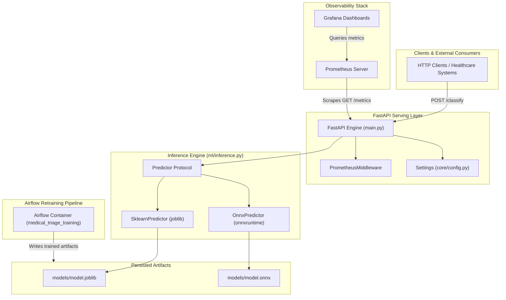
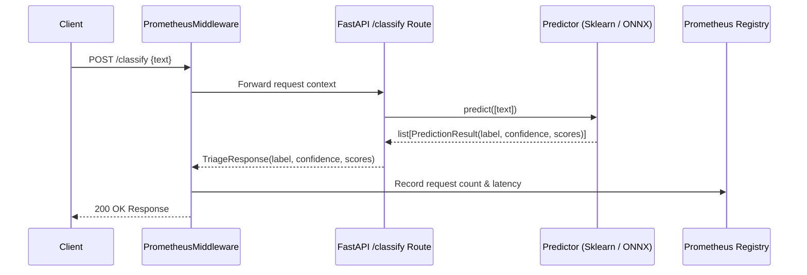
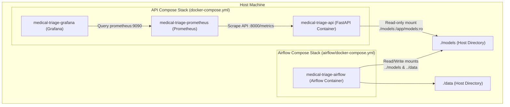

# Architecture & System Overview

The **Medical Triage MLOps Platform** is an enterprise-ready microservice platform designed to automate the classification of medical reports and clinical text into standardized urgency categories (`urgente`, `atenção`, `normal`). Built with FastAPI, Scikit-Learn, ONNX Runtime, Apache Airflow, Prometheus, and Grafana, the system supports high-performance inference, automated retraining pipelines, centralized telemetry, and multi-backend execution.

---

## High-Level System Architecture

The system is structured into separate runtime boundaries for online inference serving, offline model retraining orchestration, and system observability.


*System architecture diagram illustrating the interaction boundaries between inference clients, FastAPI runtime backends, artifact storage, Airflow DAG orchestration, and Prometheus/Grafana telemetry.*

---

## Core Components & Responsibilities

| Component | Repository Path | Primary Responsibility | Key Interfaces / Artifacts |
|---|---|---|---|
| **API Serving Layer** | `src/medical_triage_mlops/api/main.py` | Exposes REST endpoints, manages application lifespan, handles dependency injection for model predictors. | `POST /classify`, `GET /health`, `GET /metrics` |
| **Inference Engine** | `src/medical_triage_mlops/ml/inference.py` | Provides runtime prediction implementations for both Scikit-Learn pipelines and ONNX Runtime graphs. | `Predictor` protocol, `SklearnPredictor`, `OnnxPredictor` |
| **Configuration Manager** | `src/medical_triage_mlops/core/config.py` | Parses environment variables and `.env` files via Pydantic Settings into immutable application configurations. | `Settings`, `get_settings()` |
| **Data & Model Pipelines** | `src/medical_triage_mlops/ml/data.py`<br>`src/medical_triage_mlops/ml/train.py`<br>`src/medical_triage_mlops/ml/onnx_convert.py` | Downloads Kaggle dataset, maps medical categories to urgency levels, trains TF-IDF + Logistic Regression models, and exports ONNX graphs. | `dataset.csv`, `model.joblib`, `model.onnx` |
| **DAG Orchestration** | `airflow/dags/medical_triage_training_dag.py` | Automates ingestion, preprocessing, training, and ONNX conversion tasks inside Apache Airflow. | `medical_triage_training` DAG |
| **Telemetry & Metrics** | `src/medical_triage_mlops/monitoring/metrics.py` | Middleware collecting HTTP request counts and latency distributions exposed via Prometheus format. | `http_requests_total`, `http_request_duration_seconds` |

---

## Runtime Inference Flow & Backends

The application abstracts model inference behind a structural Python `Protocol` named `Predictor`. This decoupled design allows the API layer to serve requests without coupling to a specific execution engine.


*Request sequence diagram for the `/classify` endpoint highlighting middleware latency measurement and backend prediction delegation.*

### Scikit-Learn Backend (`SklearnPredictor`)
Loads a serialized Scikit-Learn `Pipeline` containing `TfidfVectorizer` (up to 20,000 features, English stop words) and `LogisticRegression` (maximum 1,000 iterations). Probabilities are obtained using `.predict_proba(texts)`, and class labels are derived directly from the fitted pipeline's `.classes_` attribute.

### ONNX Runtime Backend (`OnnxPredictor`)
Loads an optimized ONNX model graph executed via `onnxruntime.InferenceSession`. Input clinical text is passed as a 2D string NumPy array (`dtype=object`).

> **Class Order Invariance**: The ONNX graph export process does not attach target class label names directly to output tensor nodes. To maintain identical output mappings as Scikit-Learn, `OnnxPredictor` sorts class labels explicitly using `sorted(URGENCY_LABELS)` (`['atenção', 'normal', 'urgente']`). This guarantees consistency with Scikit-Learn's default `classes_ = sorted(unique(y))` behavior.

### Backend Selection Mechanism
The backend is selected dynamically when the API starts or when `get_predictor()` is invoked, based on the `MODEL_BACKEND` environment variable (`"sklearn"` vs `"onnx"`):

```python
# src/medical_triage_mlops/ml/inference.py
def get_predictor(model_backend: str, model_path: Path, onnx_model_path: Path) -> Predictor:
    if model_backend == "onnx":
        return OnnxPredictor(onnx_model_path)
    return SklearnPredictor(model_path)
```

---

## Application Lifespan & Configuration Management

Configuration is centralized in `src/medical_triage_mlops/core/config.py` using `pydantic-settings`. Settings are cached across function calls using `@lru_cache`.

### Key Configuration Variables

- `APP_HOST` / `APP_PORT`: Network binding configurations (default `0.0.0.0:8000`).
- `MODEL_PATH`: Location of the Scikit-Learn `model.joblib` binary (default `models/model.joblib`).
- `ONNX_MODEL_PATH`: Location of the converted ONNX graph (default `models/model.onnx`).
- `MODEL_BACKEND`: Runtime engine selector (`"sklearn"` or `"onnx"`).
- `LOG_LEVEL`: Logging output threshold (default `"INFO"`).

### FastAPI Application Lifespan

The FastAPI application uses an `@asynccontextmanager` lifespan handler during server initialization:

1. Loads configured settings via `get_settings()`.
2. Attempts to instantiate the specified `Predictor` (`SklearnPredictor` or `OnnxPredictor`).
3. Binds the loaded predictor instance to `app.state.predictor`.
4. If model files are missing or unreadable, logs a warning and sets `app.state.predictor = None`. The `/health` endpoint remains accessible, while calls to `/classify` return an `HTTP 503 Service Unavailable` error until models are generated.

---

## Training Pipeline & Airflow Orchestration

Model retraining and conversion workflows are fully automated using an Apache Airflow DAG (`medical_triage_training_dag.py`).

<!-- openwiki: mermaid parse failed and this diagram was converted to a text fence so it does not break rendering. Fix the diagram source and restore the mermaid fence. Parser error: Heuristic: an unescaped angle bracket inside a label breaks rendering; rephrase the label. -->
```text
flowchart LR
    Ingest["1. Ingest Data<br>(download_raw_dataset)"] --> Preprocess["2. Preprocess Data<br>(build_processed_dataset)"]
    Preprocess --> Train["3. Train Model<br>(train_model & save_model)"]
    Train --> Convert["4. Convert to ONNX<br>(convert_pipeline_to_onnx)"]
```
*Airflow DAG task execution lifecycle for the medical_triage_training pipeline.*

1. **Ingest Data (`ingest_data`)**: Uses `kagglehub` to download the Medical Abstracts TC Corpus (`saharalaa/medical-abstracts-tc-corpus`) and copies `medical_tc_train.csv` and `medical_tc_test.csv` into `data/raw/` using `shutil.copyfile` to prevent bind-mount permission issues under Docker containers.
2. **Preprocess Data (`preprocess_data`)**: Concatentates train and test subsets and maps the 5 condition category labels into 3 clinical urgency tiers (`CONDITION_TO_URGENCY`), writing `data/processed/dataset.csv`:
   - `4 (cardiovascular)` $\rightarrow$ `urgente`
   - `1 (neoplasms)` & `3 (nervous system)` $\rightarrow$ `atenção`
   - `2 (digestive system)` & `5 (general pathological)` $\rightarrow$ `normal`
3. **Train Model (`train_model_task`)**: Fits the TF-IDF vectorizer and logistic regression classifier on processed text, evaluates classification metrics, and serializes the pipeline to `models/model.joblib`.
4. **Convert to ONNX (`convert_to_onnx_task`)**: Converts the `.joblib` pipeline using `skl2onnx.convert_sklearn` with `StringTensorType([None, 1])` and option `zipmap: False` to output raw probability matrices saved to `models/model.onnx`.

---

## Containerization & Operational Topology

The service ecosystem is managed via Docker Compose and multi-stage Docker builds.


*Container topology and volume mounting relationship across API, telemetry, and Airflow orchestration stacks.*

### Multi-Stage Container Build (`Dockerfile`)
The main application image uses a two-stage build process with Astral's `uv` package manager:
- **Builder Stage**: Base `python:3.12-slim`, installs `uv`, copies dependency locks (`pyproject.toml`, `uv.lock`), executes `uv sync --frozen --no-dev`, and sets up the virtual environment (`.venv`).
- **Runtime Stage**: Copies only `.venv` and source files from builder into a fresh `python:3.12-slim` image, minimizing container footprint and eliminating build toolchains.

### Service Port Map

| Service Name | Container Name | Port Mapping | Configuration Reference |
|---|---|---|---|
| `api` | `medical-triage-api` | `8000:8000` | `docker-compose.yml` |
| `prometheus` | `medical-triage-prometheus` | `9090:9090` | `monitoring/prometheus/prometheus.yml` |
| `grafana` | `medical-triage-grafana` | `3000:3000` | `monitoring/grafana/` |
| `airflow` | `medical-triage-airflow` | `8080:8080` | `airflow/docker-compose.yml` |

---

## Related Documentation

- [Quickstart](../quickstart.md) - Setup instructions, dataset generation, and model training steps.
- [Inference & Serving](../concepts/inference-and-serving.md) - Deep dive into Scikit-Learn vs. ONNX latency, memory, and throughput tradeoffs.
- [Monitoring & Telemetry](../operations/monitoring-and-telemetry.md) - Overview of Prometheus counters, histograms, and Grafana dashboard provisioning.
- [Airflow Orchestration](../workflows/airflow-orchestration.md) - Guide to managing, scheduling, and monitoring retraining DAGs.
