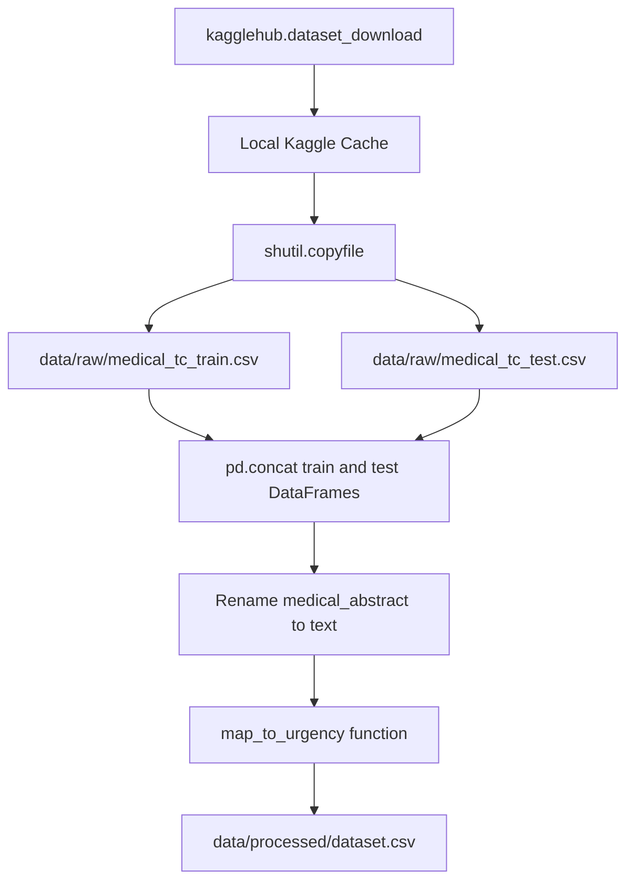
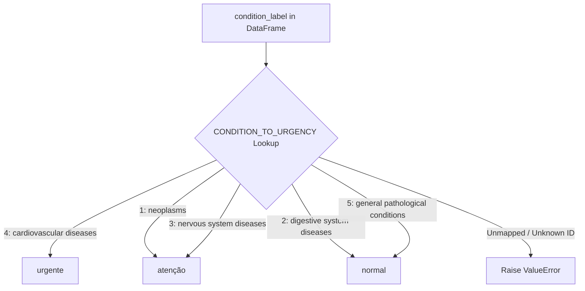

# Data Pipeline & Urgency Mapping

The **Data Pipeline & Urgency Mapping** subsystem is responsible for fetching raw medical text abstracts, cleaning and normalizing the dataset structure, mapping source disease category codes to standardized clinical urgency levels, and outputting processed data for model training and evaluation.

The raw dataset originates from Kaggle's Medical Abstracts TC Corpus (`saharalaa/medical-abstracts-tc-corpus`). Because the source corpus provides disease condition categories rather than clinical urgency triage classifications, the data pipeline applies a pedagogical mapping rule to assign every text sample to one of three target urgency tiers: `normal`, `atenção`, or `urgente`.

---

## Data Pipeline Architecture

The data pipeline processes raw CSV files downloaded from Kaggle into a unified processed CSV file (`data/processed/dataset.csv`).


Raw data ingestion and file transformation workflow from Kaggle corpus download to processed CSV export.

### Data Ingestion and File Handling

Raw dataset acquisition is implemented in `download_raw_dataset(dest_dir: Path)` within `medical_triage_mlops.ml.data`.

1. **Kaggle API Integration**: Uses `kagglehub.dataset_download("saharalaa/medical-abstracts-tc-corpus")` to fetch the source corpus into a local user cache directory.
2. **File Isolation**: Copies two raw CSV artifacts—`medical_tc_train.csv` and `medical_tc_test.csv`—from the cache directory to the local project directory `data/raw/`.
3. **Cross-Platform Copy Invariant**: Files are copied using `shutil.copyfile` instead of `shutil.copy` or `shutil.copy2`. This ensures only file content is copied, avoiding permission and metadata transfer failures (`PermissionError`) common when executing inside Docker bind mounts on Windows hosts (such as Docker Desktop).

---

## Dataset Normalization & Cleaning

Data loading and structural transformation are handled by `load_raw_dataset(raw_dir: Path)`:

1. **Ingestion**: Reads both `medical_tc_train.csv` and `medical_tc_test.csv` into pandas DataFrames.
2. **Concatenation**: Combines train and test sets into a single dataset using `pd.concat([train_df, test_df], ignore_index=True)`.
3. **Column Renaming**: Renames the raw source text column `medical_abstract` to `text`.
4. **Feature Selection**: Restricts DataFrame columns strictly to `text` and `condition_label`, discarding unneeded metadata.

---

## Disease Condition to Urgency Level Mapping

The Medical Abstracts TC Corpus categorizes abstract texts into five medical condition domain IDs (`condition_label`). To support clinical triage classification, these conditions are mapped to three target urgency levels defined in `medical_triage_mlops.core.labels`.


Logic mapping disease condition labels (1–5) to clinical urgency tiers and raising an exception for unknown identifiers.

### Label Definitions & Mapping Table

Target urgency classes are declared as constants in `medical_triage_mlops.core.labels`:

- `URGENCY_NORMAL = "normal"`
- `URGENCY_ATENCAO = "atenção"`
- `URGENCY_URGENTE = "urgente"`
- `URGENCY_LABELS = ["normal", "atenção", "urgente"]`

The mapping dictionary `CONDITION_TO_URGENCY` links each integer `condition_label` to its corresponding urgency tier:

| `condition_label` ID | Condition Category Name (`CONDITION_NAMES`) | Mapped Urgency Level (`label`) |
| :--- | :--- | :--- |
| **1** | Neoplasms | `atenção` |
| **2** | Digestive system diseases | `normal` |
| **3** | Nervous system diseases | `atenção` |
| **4** | Cardiovascular diseases | `urgente` |
| **5** | General pathological conditions | `normal` |

*Note: This mapping is a documented pedagogical simplification designed to demonstrate end-to-end MLOps triage workflows, not an actual clinical diagnostic rule.*

### Mapping Execution & Invariant Validation

Mapping is performed by `map_to_urgency(df: pd.DataFrame)`:

- Applies `.map(CONDITION_TO_URGENCY)` to create the target column `label`.
- **Validation Invariant**: Checks for any unmapped or missing labels (`mapped['label'].isna()`). If any row contains an unmapped `condition_label`, the function raises a `ValueError` listing the invalid condition values (e.g. `Valores de condition_label sem mapeamento: [bad_values]`).
- Outputs a clean DataFrame containing only the `text` and `label` columns.

---

## Processed CSV Generation

The function `build_processed_dataset(raw_dir: Path, processed_dir: Path)` coordinates data loading, urgency mapping, and directory management:

1. Ensures the target output directory `data/processed/` exists (`processed_dir.mkdir(parents=True, exist_ok=True)`).
2. Chains raw dataset loading and urgency mapping: `map_to_urgency(load_raw_dataset(raw_dir))`.
3. Writes the final dataset to `data/processed/dataset.csv` with `index=False`.

---

## Operational Entrypoints

The data pipeline can be executed via two primary interfaces:

1. **Command Line Interface**:
   Executed via `uv`:
   ```bash
   uv run python scripts/prepare_dataset.py
   ```
   The script `scripts/prepare_dataset.py` downloads raw data to `data/raw`, processes and maps it, saves `data/processed/dataset.csv`, and prints label class counts.

2. **Airflow DAG Tasks**:
   In automated MLOps pipelines, dataset preparation is split into two sequential Airflow tasks within `airflow/dags/medical_triage_training_dag.py`:
   - `ingest_data`: Calls `download_raw_dataset(RAW_DIR)`.
   - `preprocess_data`: Calls `build_processed_dataset(RAW_DIR, PROCESSED_DIR)`.

---

## Testing & Automated Verification

Unit tests in `tests/unit/test_data.py` verify data preparation invariants:

- `test_map_to_urgency_maps_all_known_condition_labels`: Validates that all condition labels 1–5 map correctly to `normal`, `atenção`, and `urgente`, producing columns `['text', 'label']`.
- `test_map_to_urgency_raises_for_unknown_condition_label`: Asserts that passing an unmapped condition label (e.g. `99`) raises a `ValueError` containing `"sem mapeamento"`.

---

## Related Documentation

- [Airflow Orchestration](../workflows/airflow-orchestration.md) - Pipeline scheduling and task orchestration for data ingestion and preprocessing.
- [Training and ONNX Conversion](../workflows/training-and-onnx-conversion.md) - Model training pipeline consuming `data/processed/dataset.csv`.
