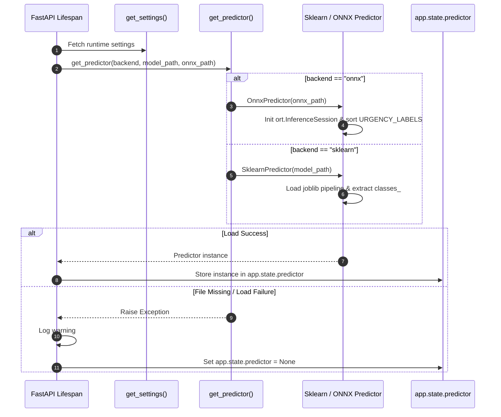
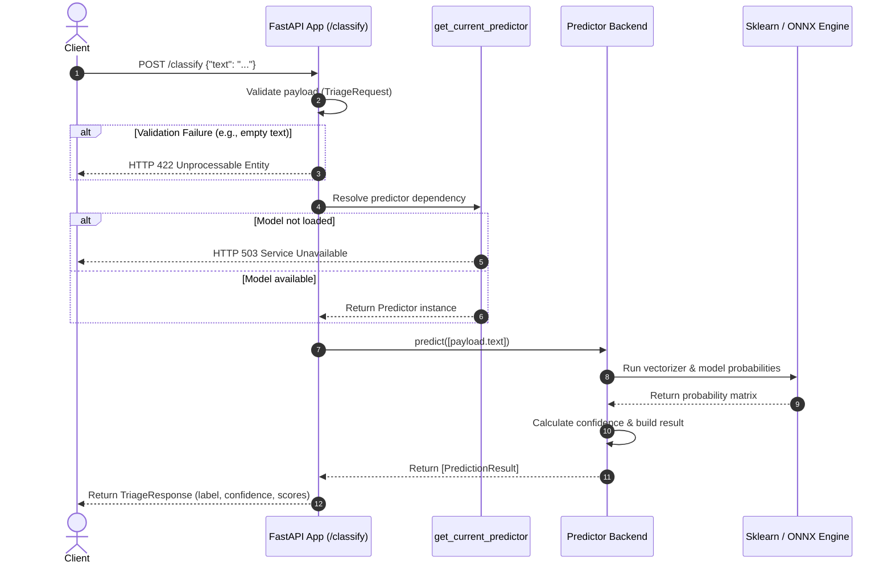

# Inference Engine & API Serving

The serving subsystem provides HTTP prediction endpoints for medical document urgency classification. It bridges client HTTP requests with underlying machine learning models through a backend-agnostic prediction interface. The architecture supports model switching between Scikit-Learn joblib pipelines and ONNX Runtime engines without changing the public REST API contract or request handling logic.

For overall architectural context, see [System Architecture](../architecture/overview.md). Details regarding offline model training and ONNX serialization are documented in [Training & ONNX Conversion](../workflows/training-and-onnx-conversion.md), while metrics collection and health monitoring are described in [Monitoring & Telemetry](../operations/monitoring-and-telemetry.md).

---

## Lifespan Model Initialization & Application State

The FastAPI application manages model lifecycle through an asynchronous context manager lifespan function. Model loading occurs at application startup, storing the initialized predictor directly on the FastAPI application state (`app.state.predictor`).


*Application lifespan initialization flow loading the configured model backend into application state on startup.*

### Model Loading Logic & Configuration

During lifespan execution, the service invokes `get_settings()` to inspect runtime configuration options (`model_backend`, `model_path`, and `onnx_model_path`).

- If model initialization succeeds, the created `Predictor` object is assigned to `app.state.predictor`.
- If model loading fails (for instance, if the model file does not exist on disk), the lifespan context manager catches the exception, logs a warning message (`"Nenhum modelo encontrado em ... — treine o modelo antes de usar /classify."`), and explicitly sets `app.state.predictor = None`. This ensures the web application starts and remains responsive for health checks even when model artifacts are absent.

### Dependency Injection (`get_current_predictor`)

Every prediction request uses FastAPI's dependency injection system to retrieve the active model instance. The helper function `get_current_predictor(request: Request)` retrieves `request.app.state.predictor`. If the attribute is `None` (uninitialized or missing model artifact), it raises an `HTTPException` with status `503 Service Unavailable` and detail `"Modelo não carregado. Treine o modelo primeiro."`.

---

## Predictor Protocol & Dual Model Backends

To decouple model execution details from HTTP routing, the inference engine defines a Python `Protocol` abstraction and uniform data structures.

### The `Predictor` Protocol & `PredictionResult`

The prediction abstraction consists of two core structures:

1. **`PredictionResult` Data Class**: Holds the predicted class `label` (string), the prediction `confidence` score (float), and a `scores` dictionary mapping every candidate class label to its predicted probability.
2. **`Predictor` Protocol**: Enforces the method signature `predict(self, texts: list[str]) -> list[PredictionResult]`.

### Factory Function (`get_predictor`)

The factory function `get_predictor(model_backend, model_path, onnx_model_path)` selects and instantiates the appropriate backend implementation based on configuration:

- When `model_backend` equals `"onnx"`, `get_predictor` returns an instance of `OnnxPredictor(onnx_model_path)`.
- For all other backend values (such as `"sklearn"`), it returns a `SklearnPredictor(model_path)`.

<!-- openwiki: mermaid parse failed and this diagram was converted to a text fence so it does not break rendering. Fix the diagram source and restore the mermaid fence. Parser error: Heuristic: an unescaped angle bracket inside a label breaks rendering; rephrase the label. -->
```text
classDiagram
    class Predictor {
        <<protocol>>
        +predict(texts: list~str~) list~PredictionResult~
    }
    class SklearnPredictor {
        -_pipeline: Pipeline
        +predict(texts: list~str~) list~PredictionResult~
    }
    class OnnxPredictor {
        -_session: InferenceSession
        -_classes: list~str~
        -_input_name: str
        +predict(texts: list~str~) list~PredictionResult~
    }
    class PredictionResult {
        +label: str
        +confidence: float
        +scores: dict~str, float~
    }

    Predictor <|.. SklearnPredictor
    Predictor <|.. OnnxPredictor
    SklearnPredictor ..> PredictionResult : returns
    OnnxPredictor ..> PredictionResult : returns
```
*Class structure showing the Predictor protocol and concrete backend implementations.*

### Scikit-Learn Backend (`SklearnPredictor`)

`SklearnPredictor` wraps a Scikit-Learn text classification pipeline loaded from disk using `joblib`.
- **Initialization**: Calls `load_model(model_path)` to load the serialized `Pipeline` artifact containing `TfidfVectorizer` and `LogisticRegression`.
- **Inference**: Extracts target classes via `self._pipeline.classes_`, calls `predict_proba(texts)` to obtain class probability arrays, and passes these to `_build_results()`.

### ONNX Runtime Backend (`OnnxPredictor`)

`OnnxPredictor` provides optimized inference execution via `onnxruntime.InferenceSession`.
- **Initialization**: Loads the `.onnx` graph into an `ort.InferenceSession`. It retrieves the primary input tensor name using `self._session.get_inputs()[0].name`.
- **Class Label Ordering**: Class labels are omitted from exported ONNX computational graphs. Because Scikit-Learn deterministically orders `classes_ = sorted(unique(y))`, `OnnxPredictor` reproduces this exact ordering by setting `self._classes = sorted(URGENCY_LABELS)` (yielding `["atenção", "normal", "urgente"]`).
- **Input Preparation**: Input text strings are reshaped into a 2D NumPy array with `dtype=object` (`np.array([[text] for text in texts], dtype=object)`).
- **Inference Execution**: Executes `session.run(None, {self._input_name: input_array})` and passes output probability matrices to `_build_results()`.

---

## Score Calculation & Output Derivation

Both backends share the internal helper function `_build_results(classes, probabilities)` to format raw numerical output into domain-specific structured results:

1. **Probability Dict Mapping**: For each text row, maps each class name in `classes` to its float probability score (`scores = {label: float(score) for label, score in zip(classes, row, strict=True)}`).
2. **Top Class Selection**: Identifies the predicted label with highest probability using `max(scores, key=scores.get)`.
3. **Confidence Scoring**: Assigns `confidence = scores[best_label]`.
4. **Result Packaging**: Packages parameters into a `PredictionResult(label=best_label, confidence=confidence, scores=scores)` object.

---

## Request Handling & API Schemas

The primary prediction endpoint `/classify` accepts client payloads, validates input schema constraints, runs inference, and returns serialized predictions.


*Request execution flow for document classification from client HTTP POST through dependency validation, model prediction, and response serialization.*

### API Schemas (`src/medical_triage_mlops/api/schemas.py`)

- **`TriageRequest`**: Pydantic input model containing a single field `text: str`. The field includes `Field(min_length=1)`, ensuring empty text strings are rejected immediately by FastAPI with HTTP status `422 Unprocessable Entity`.
- **`TriageResponse`**: Pydantic response model returning:
  - `label`: The top predicted urgency level string (`"normal"`, `"atenção"`, or `"urgente"`).
  - `confidence`: Floating-point probability value for the winning class.
  - `scores`: Full dictionary mapping each urgency level to its estimated probability.

### The `/classify` Endpoint Definition

The POST `/classify` route receives `payload: TriageRequest` and injects `predictor: Predictor = Depends(get_current_predictor)`.
It calls `result = predictor.predict([payload.text])[0]` and constructs `TriageResponse(label=result.label, confidence=result.confidence, scores=result.scores)`.

---

## API Endpoints Reference

| Endpoint | Method | Tag | Description | Output |
| :--- | :--- | :--- | :--- | :--- |
| `/classify` | `POST` | `Triage` | Classifies medical text into urgency levels (`normal`, `atenção`, `urgente`). | `TriageResponse` |
| `/health` | `GET` | `Health` | Health check endpoint returning service readiness. | `{"status": "ok"}` |
| `/metrics` | `GET` | `Monitoring` | Exposes Prometheus HTTP request count and latency metrics. | Prometheus exposition format |

---

## Testing & Dependency Overrides

The architecture supports testing without requiring real model artifacts or disk I/O. FastAPI's `dependency_overrides` mechanism allows unit tests to replace `get_current_predictor` with test doubles such as `FakePredictor`:

```python
class FakePredictor:
    def predict(self, texts: list[str]) -> list[PredictionResult]:
        return [
            PredictionResult(
                label="urgente",
                confidence=0.9,
                scores={"normal": 0.05, "atenção": 0.05, "urgente": 0.9},
            )
            for _ in texts
        ]

app.dependency_overrides[get_current_predictor] = lambda: FakePredictor()
```

This pattern enables testing:
1. **HTTP 200 Success**: Verifies JSON schema deserialization and field mapping.
2. **HTTP 422 Validation Errors**: Validates that payloads failing input validation (e.g. `{"text": ""}`) are rejected before model execution.
3. **HTTP 503 Service Unavailable**: Confirms appropriate error response when `app.state.predictor` is `None`.
4. **Backend Parity**: Unit tests in `tests/unit/test_onnx_convert.py` verify that `OnnxPredictor` generates identical label predictions to `SklearnPredictor` across representative test inputs.
