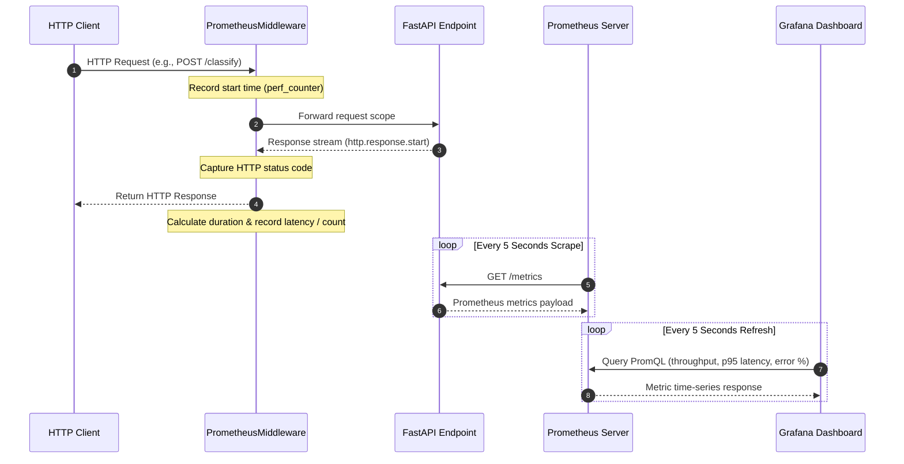

# Monitoring & Telemetry Stack

The **Medical Triage MLOps Platform** incorporates a full-stack observability and operational telemetry pipeline designed to monitor HTTP traffic, request latencies, endpoint availability, and model serving error rates in real time. The telemetry system spans three primary architectural tiers:

1. **ASGI Middleware Instrumentation**: Low-overhead request interceptor (`PrometheusMiddleware`) running inside FastAPI to generate metric samples for every HTTP transaction.
2. **Prometheus Metric Aggregation**: A dedicated Prometheus instance configured with high-frequency scraping intervals to harvest metrics exposed at the `/metrics` endpoint.
3. **Grafana Dashboards**: Automated dashboard and datasource provisioning supplying visual operational monitoring of 95th-percentile latencies, throughput, and HTTP 5xx error ratios.

---

## Telemetry Data Flow Architecture

The data flow spans from inbound client calls through the ASGI middleware to time-series storage and visual dashboard rendering.


*Telemetry data flow illustrating request timing intercept in ASGI middleware, Prometheus polling, and Grafana dashboard querying.*

---

## ASGI Middleware & Metric Instrumentation

The core instrumentation logic is implemented as custom ASGI middleware in `src/medical_triage_mlops/monitoring/metrics.py`.

### Metric Definitions

The platform defines two global Prometheus metric collectors using `prometheus_client`:

*   **`http_requests_total`** (`Counter`): Tracks the total count of HTTP requests processed by the API. It is labeled by `method` (e.g., `GET`, `POST`), `path` (e.g., `/classify`, `/health`), and `status` (e.g., `200`, `422`, `500`).
*   **`http_request_duration_seconds`** (`Histogram`): Tracks request latency distributions in seconds. It is labeled by `method` and `path`.

### Middleware Lifecycle (`PrometheusMiddleware`)

The `PrometheusMiddleware` intercepts every event traversing the ASGI application pipeline:

1.  **Scope Validation**: The middleware inspects `scope["type"]`. Non-HTTP ASGI scopes (such as WebSocket connections or lifecespans) bypass measurement and are passed directly to `self.app(scope, receive, send)`.
2.  **Timing & Initialization**: For HTTP requests, `time.perf_counter()` captures the initial high-resolution timestamp. A status dictionary `status_holder = {"code": 500}` is initialized to ensure that if an unhandled exception prevents response start, the request is correctly tallied as an HTTP 500 server error.
3.  **Response Interception**: An internal `send_wrapper` function monitors outbound ASGI messages. When `message["type"] == "http.response.start"` is detected, the actual status code from `message["status"]` updates `status_holder["code"]`.
4.  **Final Metric Recording**: In a `finally` block—guaranteeing execution regardless of request completion or unhandled exceptions—the elapsed duration is calculated and recorded into `REQUEST_LATENCY`, and `REQUEST_COUNT` is incremented.

### Metrics Endpoint (`/metrics`)

The endpoint `/metrics` exposes cumulative process metrics via `metrics_endpoint(_: Request)`. It invokes Prometheus's `generate_latest()` to serialize metric registries into text format using `CONTENT_TYPE_LATEST` (`text/plain; version=0.0.4; charset=utf-8`).

---

## FastAPI Route Integration

The telemetry components are mounted to the FastAPI application during initialization in `src/medical_triage_mlops/api/main.py`:

*   `app.add_middleware(PrometheusMiddleware)` ensures all incoming HTTP requests pass through the instrumentation layer before entering route dependencies or endpoint handlers such as `/classify` or `/health`.
*   `app.add_api_route("/metrics", metrics_endpoint, methods=["GET"], tags=["Monitoring"])` registers the scraper endpoint under the `Monitoring` tag.

For details on endpoint request handling and predictor dependency injection, see [Inference & Serving](../concepts/inference-and-serving.md) and [Architecture & System Overview](../architecture/overview.md).

---

## Prometheus Scraping Configuration

The Prometheus server is deployed as a Docker service (`medical-triage-prometheus`) using the official `prom/prometheus:v2.55.1` image.

### Scraper Settings (`monitoring/prometheus/prometheus.yml`)

Prometheus is configured for low-latency MLOps monitoring with short scrape and evaluation cycles:

*   **`scrape_interval`**: Set to `5s` to provide near-real-time resolution of inference traffic spikes.
*   **`evaluation_interval`**: Set to `5s` for prompt rule evaluation.
*   **Scrape Target**: Job `medical-triage-api` targets `api:8000` on path `/metrics`.

---

## Grafana Provisioning & Visual Dashboards

Grafana (`grafana/grafana:11.3.1`) runs on port `3000` with automated datasource and dashboard provisioning.

### Datasource Configuration

The file `monitoring/grafana/provisioning/datasources/datasource.yml` provisions Prometheus as the default datasource:

*   **Name**: `Prometheus` (UID: `Prometheus`)
*   **URL**: `http://prometheus:9090` via proxy access mode.
*   **Permissions**: Set as read-only (`editable: false`) and default (`isDefault: true`).

### Dashboard Provider Configuration

Dashboard provisioning is managed by `monitoring/grafana/provisioning/dashboards/dashboard.yml`. It defines the `Medical Triage Dashboards` provider, scanning `/var/lib/grafana/dashboards` for JSON definitions every 30 seconds (`updateIntervalSeconds: 30`).

### Dashboard Visual Panels (`medical-triage-dashboard.json`)

The provisioned dashboard `Medical Triage API` (`uid: medical-triage-api`) refreshes every 5 seconds over a 15-minute default window (`now-15m` to `now`). It features three key visual timeseries panels:

1.  **Total Requests (Rate / second)**:
    *   **PromQL**: `sum(rate(http_requests_total[1m])) by (path)`
    *   **Purpose**: Displays per-endpoint request throughput over 1-minute rate windows.
2.  **Latency (p95, Seconds)**:
    *   **PromQL**: `histogram_quantile(0.95, sum(rate(http_request_duration_seconds_bucket[5m])) by (le, path))`
    *   **Purpose**: Computes the 95th percentile request duration per path across 5-minute windows, allowing operators to spot tail latency anomalies during model inference.
3.  **Error Rate (%)**:
    *   **PromQL**: `100 * sum(rate(http_requests_total{status=~"5.."}[5m])) / sum(rate(http_requests_total[5m]))`
    *   **Purpose**: Calculates the percentage of HTTP 5xx responses relative to total traffic, alerting team members to server-side exceptions.

---

## Docker Orchestration

All telemetry containers are configured in `docker-compose.yml`:

| Service | Container Name | Port Mapping | Dependencies | Mounted Volumes |
| :--- | :--- | :--- | :--- | :--- |
| `api` | `medical-triage-api` | `8000:8000` | — | `./models:/app/models:ro` |
| `prometheus` | `medical-triage-prometheus` | `9090:9090` | `api` | `./monitoring/prometheus/prometheus.yml:/etc/prometheus/prometheus.yml:ro` |
| `grafana` | `medical-triage-grafana` | `3000:3000` | `prometheus` | `./monitoring/grafana/provisioning:/etc/grafana/provisioning:ro`, `./monitoring/grafana/dashboards:/var/lib/grafana/dashboards:ro` |

Grafana is configured with environment variables allowing anonymous viewer access (`GF_AUTH_ANONYMOUS_ENABLED=true`, `GF_AUTH_ANONYMOUS_ORG_ROLE=Viewer`) while securing administrative access (`GF_SECURITY_ADMIN_USER=admin`).

---

## Verification & Testing

Platform monitoring logic is verified through automated unit testing in `tests/unit/test_api_classify.py`.

The test `test_metrics_endpoint_exposes_request_count` performs the following steps:
1. Sends a request to `/health` using FastAPI `TestClient`.
2. Sends a GET request to `/metrics`.
3. Asserts that the HTTP status code is `200` and the response body contains `"http_requests_total"`.

To manually verify the telemetry stack while running the system via Docker Compose:

```bash
# 1. Trigger sample HTTP request
curl -X POST http://localhost:8000/classify \
  -H "Content-Type: application/json" \
  -d '{"text": "Dor torácica aguda e falta de ar."}'

# 2. Inspect raw metrics format
curl http://localhost:8000/metrics | grep http_requests_total

# 3. Access Grafana dashboards
# Navigate to http://localhost:3000 to view the provisioned "Medical Triage API" dashboard.
```
