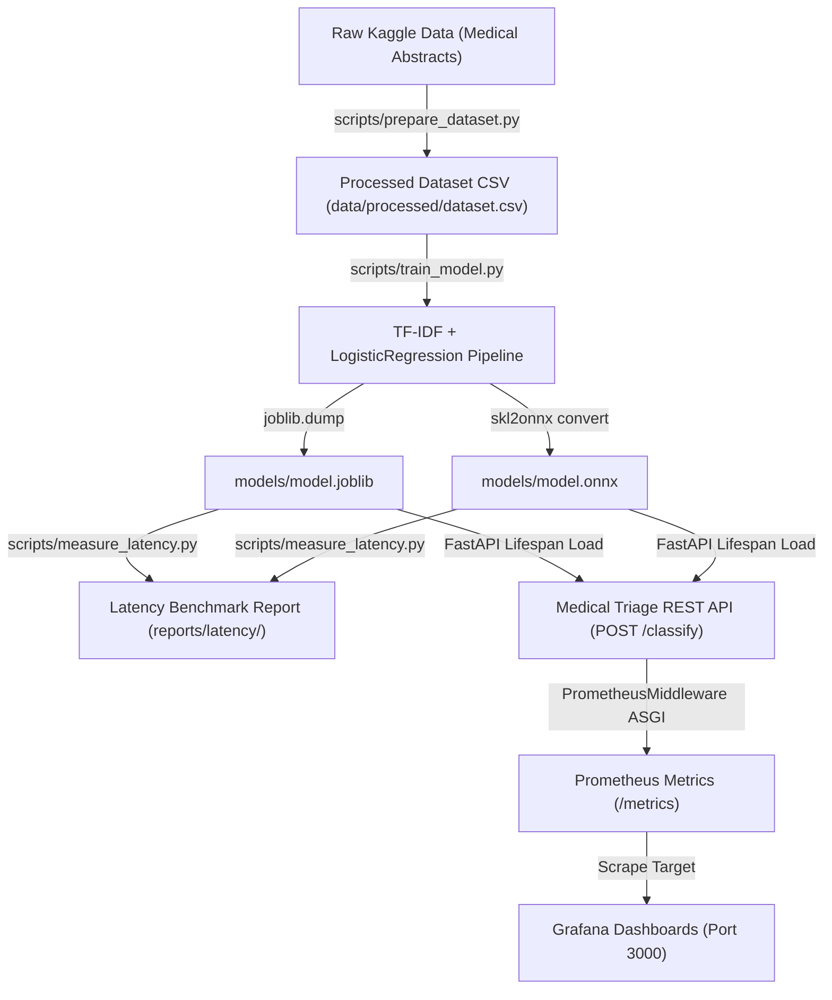
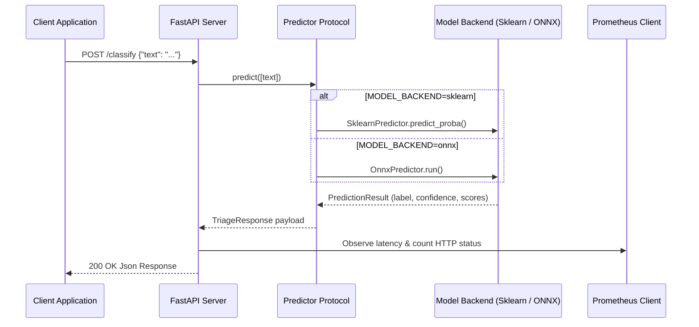

# Quickstart & Task Routing

The **Medical Triage MLOps** platform is an end-to-end machine learning system designed to classify medical report texts (`medical_abstract`) into three clinical urgency levels: `normal`, `atenção`, and `urgente`. Built for production readiness, the system integrates automated data ingestion, dual inference runtime backends (Scikit-Learn `.joblib` and ONNX Runtime `.onnx`), real-time REST serving via FastAPI, metrics telemetry with Prometheus and Grafana, workflow orchestration with Apache Airflow, and CI/CD quality gates.

This guide provides step-by-step instructions for setting up the local development environment, running model pipelines, launching the API and telemetry stack, running tests, and navigating the codebase using the task-routing map.

---

## Developer Onboarding & Prerequisites

### Required Tooling
Before setting up the repository, ensure the following software is installed on your workstation:
- **Git** (version 2.38+)
- **Python** 3.12+ (managed directly via `uv`)
- **uv** (fast Python package and environment manager)
- **Docker Engine** (v24.0+) & **Docker Compose** (v2.20+)

### Initial Environment Setup

1. **Clone the Repository**:
   ```bash
   git clone git@github.com:SkiereszDiego/tech-challenge-fase03.git
   cd tech-challenge-fase03
   ```

2. **Synchronize Virtual Environment & Dependencies**:
   The project relies on [`pyproject.toml`](../pyproject.toml) and `uv.lock`. Running `uv sync` installs all required runtime and development dependencies into a local `.venv`:
   ```bash
   uv sync
   ```
   To verify the Python version provisioned by `uv`:
   ```bash
   uv run python --version
   ```

3. **Configure Environment Variables**:
   Copy the template environment configuration file to create your local `.env`:
   ```bash
   cp .env.example .env
   ```

### Configuration Options

Environment variables configured in `.env` are parsed at runtime by [`src/medical_triage_mlops/core/config.py`](../src/medical_triage_mlops/core/config.py):

| Variable | Default Value | Description |
|---|---|---|
| `APP_NAME` | `Medical Triage API` | Human-readable title for FastAPI application and docs |
| `APP_ENV` | `development` | Deployment environment state (`development`, `production`) |
| `APP_HOST` | `0.0.0.0` | Network interface host binding |
| `APP_PORT` | `8000` | HTTP port for the FastAPI service |
| `MODEL_PATH` | `models/model.joblib` | Path to serialized Scikit-Learn pipeline `.joblib` file |
| `ONNX_MODEL_PATH` | `models/model.onnx` | Path to serialized ONNX model `.onnx` file |
| `MODEL_BACKEND` | `sklearn` | Selected inference engine backend (`sklearn` or `onnx`) |
| `LOG_LEVEL` | `INFO` | Application logging verbosity (`DEBUG`, `INFO`, `WARNING`, `ERROR`) |

---

## End-to-End Developer Workflow

The development lifecycle consists of four primary stages: data preparation, model training/export, latency benchmarking, and API deployment.


End-to-end data processing, model conversion, API serving, and monitoring workflow.

### Step 1: Download & Prepare Dataset
Run [`scripts/prepare_dataset.py`](../scripts/prepare_dataset.py) to fetch the Medical Abstracts TC Corpus dataset from Kaggle via `kagglehub` and map disease condition labels into three urgency categories:
```bash
uv run python scripts/prepare_dataset.py
```
*Output*: Generates `data/processed/dataset.csv` with mapped urgency target labels.

### Step 2: Train Model & Export ONNX
Run [`scripts/train_model.py`](../scripts/train_model.py) to train the TF-IDF vectorizer and Logistic Regression classifier. This script saves both the Scikit-Learn pipeline (`models/model.joblib`) and converts it to ONNX format (`models/model.onnx`) using `skl2onnx`:
```bash
uv run python scripts/train_model.py
```
*Output*: Produces `models/model.joblib` and `models/model.onnx`.

### Step 3: Measure Inference Latency
Run [`scripts/measure_latency.py`](../scripts/measure_latency.py) to execute 200 inference iterations across both Scikit-Learn and ONNX Runtime backends (following 10 warmup runs):
```bash
uv run python scripts/measure_latency.py
```
*Output*: Writes performance comparison metrics to `reports/latency/latency_comparison.json` and `reports/latency/latency_comparison.md`.

### Step 4: Run FastAPI Development Server
Start the FastAPI server locally using `fastapi dev` targeting [`src/medical_triage_mlops/api/main.py`](../src/medical_triage_mlops/api/main.py):
```bash
uv run fastapi dev src/medical_triage_mlops/api/main.py
```
Once active, interact with the service endpoints:
- **API Base**: `http://127.0.0.1:8000`
- **Health Check**: `GET http://127.0.0.1:8000/health`
- **Swagger Documentation**: `http://127.0.0.1:8000/docs`
- **Prometheus Metrics**: `GET http://127.0.0.1:8000/metrics`

To test classification via `curl`:
```bash
curl -X POST "http://127.0.0.1:8000/classify" \
  -H "Content-Type: application/json" \
  -d '{"text": "Patient presents with severe substernal chest pain, diaphoresis, and shortness of breath."}'
```

---

## Service Stack Deployment via Docker Compose

### Main Application & Observability Stack

The primary [`docker-compose.yml`](../docker-compose.yml) orchestrates the FastAPI application alongside Prometheus and Grafana for full runtime monitoring.


HTTP request flow through FastAPI middleware, Predictor abstraction, backend execution, and telemetry recording.

Start the complete observability and serving stack:
```bash
docker compose up --build
```

**Services Included**:
1. **API (`medical-triage-api`)**:
   - Port: `8000:8000`
   - Volume: Mounts `./models` as read-only at `/app/models:ro`
   - Environment: Reads `MODEL_BACKEND` (default `sklearn`)
2. **Prometheus (`medical-triage-prometheus`)**:
   - Port: `9090:9090`
   - Config: Mounts [`monitoring/prometheus/prometheus.yml`](../monitoring/prometheus/prometheus.yml) to scrape `api:8000/metrics` every 15s.
3. **Grafana (`medical-triage-grafana`)**:
   - Port: `3000:3000`
   - Pre-configured provisioning: Loads datasource and dashboard [`monitoring/grafana/dashboards/medical-triage-dashboard.json`](../monitoring/grafana/dashboards/medical-triage-dashboard.json) with HTTP request count, latency (P95), and error rate metrics. Access credentials default to `admin`/`admin` (or anonymous viewer).

### Airflow Workflow Orchestration Stack

Apache Airflow is isolated in [`airflow/docker-compose.yml`](../airflow/docker-compose.yml) to prevent dependency conflicts with the main application container.

To start the Airflow environment:
```bash
docker compose -f airflow/docker-compose.yml up --build
```
- **Airflow UI**: `http://localhost:8080` (Credentials printed in container startup log or `airflow/standalone_admin_password.txt`).
- **DAG Definition**: [`airflow/dags/medical_triage_training_dag.py`](../airflow/dags/medical_triage_training_dag.py) defines `medical_triage_training` with 4 sequential tasks:
  1. `ingest_data`: Downloads raw dataset from Kaggle to `/opt/airflow/project/data/raw`.
  2. `preprocess_data`: Constructs urgency mapping and writes `/opt/airflow/project/data/processed/dataset.csv`.
  3. `train_model`: Trains TF-IDF + LogisticRegression and saves `/opt/airflow/project/models/model.joblib`.
  4. `convert_to_onnx`: Converts pipeline to `/opt/airflow/project/models/model.onnx`.

---

## Testing & Quality Assurance Suite

Quality enforcement is managed through pytest, Ruff linting/formatting, pre-commit hooks, and GitHub Actions CI.

### Running Unit Tests
Unit tests run completely offline using synthetic datasets and mock predictors.
```bash
# Execute unit test suite
uv run pytest

# Execute tests with coverage reporting
uv run pytest --cov=medical_triage_mlops --cov-report=term-missing
```

### Static Analysis & Formatting
Code style and syntax standards are enforced via Ruff (`pyproject.toml` configuration):
```bash
# Check code for lint errors
uv run ruff check .

# Check code formatting status
uv run ruff format --check .

# Automatically fix formatting issues
uv run ruff format .
```

### Pre-commit Hooks
Install git pre-commit hooks to automatically execute linting, formatting checks, and unit tests prior to committing code:
```bash
# Install hooks
uv run pre-commit install

# Run manually against all files
uv run pre-commit run --all-files
```

### CI/CD Workflow
The GitHub Actions workflow in [`.github/workflows/ci.yml`](../.github/workflows/ci.yml) executes on every push or pull request to `main` and `develop`:
1. `lint-and-test`: Installs `uv`, syncs dev dependencies, runs `ruff check`, `ruff format --check`, and `pytest --cov`.
2. `build`: Builds the Docker image (`docker build -t medical-triage-api:${{ github.sha }} .`) upon successful test execution.

---

## Task-Routing Map

Use this task-routing matrix to locate relevant source code subdirectories and deep-dive documentation pages for specific system development tasks.

| Developer Task / Focus Area | Relevant Repository Subdirectory | Core Implementation Files | Detailed Documentation Page |
|---|---|---|---|
| **System Architecture & Design** | `/` | `Dockerfile`, `docker-compose.yml`, `pyproject.toml` | [Architecture & System Overview](architecture/overview.md) |
| **Data Ingestion & Urgency Mapping** | `src/medical_triage_mlops/ml/`, `src/medical_triage_mlops/core/` | `data.py`, `labels.py`, `scripts/prepare_dataset.py` | [Data Pipeline & Urgency Mapping](concepts/data-and-urgency-mapping.md) |
| **Model Training & ONNX Export** | `src/medical_triage_mlops/ml/`, `scripts/`, `reports/` | `train.py`, `onnx_convert.py`, `train_model.py`, `measure_latency.py` | [Model Training & ONNX Optimization Workflow](workflows/training-and-onnx-conversion.md) |
| **REST API & Inference Engine** | `src/medical_triage_mlops/api/`, `src/medical_triage_mlops/ml/` | `main.py`, `schemas.py`, `inference.py`, `config.py` | [Inference Engine & API Serving](concepts/inference-and-serving.md) |
| **Monitoring, Telemetry & Grafana** | `monitoring/`, `src/medical_triage_mlops/monitoring/` | `metrics.py`, `prometheus.yml`, `medical-triage-dashboard.json` | [Monitoring & Telemetry Stack](operations/monitoring-and-telemetry.md) |
| **Airflow Orchestration & DAGs** | `airflow/` | `dags/medical_triage_training_dag.py`, `docker-compose.yml`, `Dockerfile` | [Airflow Workflow Orchestration](workflows/airflow-orchestration.md) |
| **Testing, Quality & CI/CD** | `tests/`, `.github/` | `tests/unit/`, `.github/workflows/ci.yml`, `.pre-commit-config.yaml` | [Test Suite & Quality Assurance](testing/test-suite.md) |
