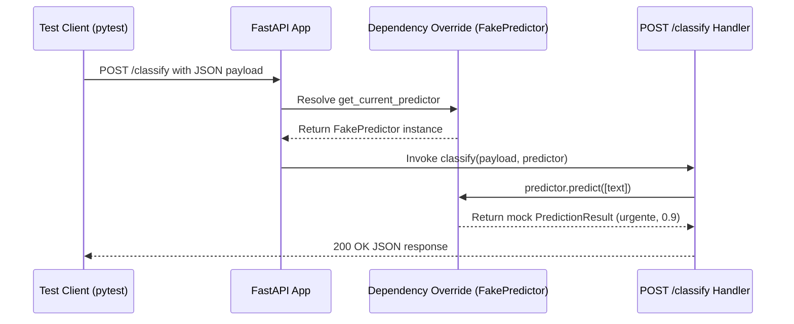
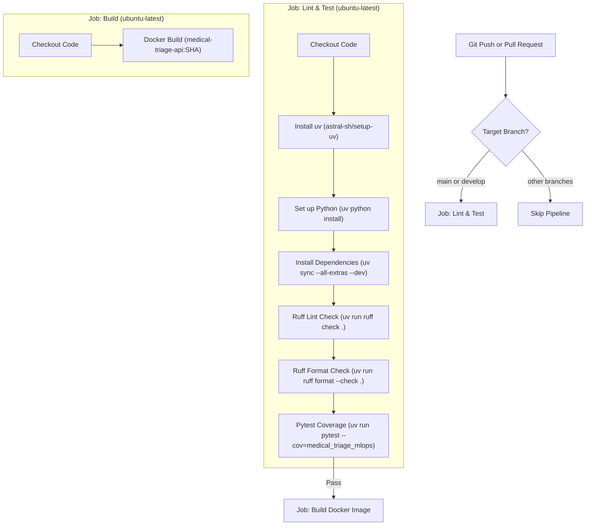

# Test Suite & Quality Assurance

Quality assurance in `medical-triage-mlops` combines automated static code analysis, unit testing with test double isolation, format enforcement, pre-commit hook integration, and multi-stage continuous integration (CI) workflows. Every code modification undergoes rigorous validation locally and in CI to ensure reliability across machine learning pipelines, ONNX conversions, and FastAPI serving endpoints.

---

## Quality Strategy & Architecture

The quality assurance strategy enforces safety across the entire lifecycle—from developer environment commits to container image packaging:

- **Static Analysis & Formatting**: Managed via **Ruff**, providing fast linting and formatting targeting Python 3.12 compatibility.
- **Unit Testing & Coverage**: Driven by **Pytest** and **pytest-cov**, organized into modular unit tests covering data preparation, model training, ONNX conversion, and API HTTP endpoints.
- **Dependency Isolation in Endpoint Tests**: Replaces model disk loading and inference execution with lightweight test doubles (`FakePredictor`) via FastAPI's `dependency_overrides` mechanism.
- **Local Pre-commit Automation**: Enforces linting, formatting, and test suites prior to git commits using `uv run --frozen`.
- **Automated CI/CD Pipeline**: Executed on GitHub Actions using `astral-sh/setup-uv@v4` to cache dependencies, execute lint and test jobs with coverage, and build a release Docker container image upon successful verification.

---

## Test Suite Organization & Pytest Configuration

### Configuration Standards

Pytest settings are centralized in `pyproject.toml` under `[tool.pytest.ini_options]`. Default options disable ambiguous warnings and explicitly define source test paths:

```toml
[tool.pytest.ini_options]
testpaths = ["tests"]
addopts = [
    "-ra",
    "--strict-markers",
]
```

Development dependencies required for testing and linting are declared in `pyproject.toml` under `[dependency-groups]`:

```toml
[dependency-groups]
dev = [
    "pre-commit>=4.6.1",
    "pytest>=9.1.1",
    "pytest-cov>=7.1.0",
    "ruff>=0.16.1",
]
```

### Fixture Management (`conftest.py`)

Shared fixtures reside in `tests/unit/conftest.py`. The primary fixture, `sample_dataframe`, constructs a synthetic `pandas.DataFrame` containing representative Portuguese medical reports categorized across three triage categories (`normal`, `atenção`, `urgente`):

```python
@pytest.fixture
def sample_dataframe() -> pd.DataFrame:
    rows = (
        [(text, URGENCY_NORMAL) for text in NORMAL_TEXTS]
        + [(text, URGENCY_ATENCAO) for text in ATENCAO_TEXTS]
        + [(text, URGENCY_URGENTE) for text in URGENTE_TEXTS]
    )
    return pd.DataFrame(rows, columns=["text", "label"])
```

This fixture generates 24 total balanced records (8 items per label class) using canonical urgency constants imported from `medical_triage_mlops.core.labels`.

### Modular Unit Tests

Unit tests live under `tests/unit/` and isolate specific system responsibilities:

| Test Module | Target Functionality | Description |
| :--- | :--- | :--- |
| `test_data.py` | `medical_triage_mlops.ml.data` | Verifies `map_to_urgency` maps Kaggle condition labels to urgency categories (`normal`, `atenção`, `urgente`) and raises `ValueError` on unmapped condition codes. |
| `test_train.py` | `medical_triage_mlops.ml.train` | Tests model training fitting (`train_model`), output metric generation, prediction behavior, and joblib serialization roundtrips (`save_model`, `load_model`). |
| `test_onnx_convert.py` | `medical_triage_mlops.ml.onnx_convert` | Validates model export to ONNX format and verifies runtime prediction parity between `scikit-learn` and `onnxruntime.InferenceSession`. |
| `test_health.py` | `medical_triage_mlops.api.main` | Asserts that `GET /health` returns HTTP status 200 with `{"status": "ok"}`. |
| `test_api_classify.py` | `medical_triage_mlops.api.main` | Tests `POST /classify` response schemas, 422 HTTP validation errors on empty inputs, and Prometheus metrics generation on `GET /metrics`. |

---

## API Testing & Dependency Overriding

When serving predictions, the FastAPI app retrieves a prediction engine instance via `get_current_predictor`, which reads `request.app.state.predictor`. To prevent unit tests from requiring trained model files on disk or executing heavy inference pipelines, `tests/unit/test_api_classify.py` overrides this dependency using a mock class `FakePredictor`.

```python
class FakePredictor:
    def predict(self, texts: list[str]) -> list[PredictionResult]:
        return [
            PredictionResult(
                label="urgente",
                confidence=0.9,
                scores={"normal": 0.05, "atenção": 0.05, "urgente": 0.9},
            )
            for _ in texts
        ]

app.dependency_overrides[get_current_predictor] = lambda: FakePredictor()
client = TestClient(app)
```


*Figure 1: Sequence of API classification testing leveraging FastAPI dependency overriding with FakePredictor.*

This pattern allows testing input validation (such as ensuring an empty body `{"text": ""}` returns HTTP status 422) and monitoring metrics endpoints (`GET /metrics`) in isolated memory. For further details on model serving implementations, see [Inference & Serving](../concepts/inference-and-serving.md).

---

## Code Style & Formatting Rules (Ruff)

The project uses [Ruff](https://github.com/astral-sh/ruff) for combined linting and code formatting. Rules are declared in `pyproject.toml` under `[tool.ruff]`:

```toml
[tool.ruff]
line-length = 100
target-version = "py312"
src = ["src", "tests"]

[tool.ruff.lint]
select = [
    "E",   # pycodestyle errors
    "F",   # Pyflakes
    "I",   # isort (import sorting)
    "B",   # flake8-bugbear
    "UP",  # pyupgrade
]

[tool.ruff.format]
quote-style = "double"
indent-style = "space"
```

- **Line Length**: Capped at 100 characters.
- **Target Version**: Python 3.12 syntax standards (`py312`).
- **Rule Sets**: Pycodestyle (`E`), Pyflakes (`F`), Import Sorting (`I`), Bugbear analysis (`B`), and automatic syntax upgrade recommendations (`UP`).
- **Formatting**: Double quotes and space indentation.

Developers and CI run Ruff using the following commands:

```bash
uv run ruff check .
uv run ruff format --check .
```

---

## Pre-commit Hook Integration

Local pre-commit hooks ensure code complies with quality standards before committing changes to Git. The configuration in `.pre-commit-config.yaml` runs tools using `uv run --frozen` to prevent modifying `uv.lock` during pre-commit checks:

```yaml
repos:
  - repo: local
    hooks:
      - id: ruff-check
        name: Ruff lint
        entry: uv run --frozen ruff check
        language: system
        types_or: [python, pyi]

      - id: ruff-format
        name: Ruff format
        entry: uv run --frozen ruff format --check
        language: system
        types_or: [python, pyi]

      - id: pytest
        name: Pytest
        entry: uv run --frozen pytest
        language: system
        pass_filenames: false
```

To install and initialize the hooks locally, refer to the setup steps in [Quickstart](../quickstart.md).

---

## GitHub Actions CI Workflow

Continuous integration is managed by GitHub Actions in `.github/workflows/ci.yml`. The workflow triggers on all code pushes and pull requests targeting the `main` and `develop` branches.


*Figure 2: GitHub Actions CI pipeline flow executing linting, formatting, coverage testing, and container image construction.*

### Workflow Structure

The workflow consists of two sequential jobs:

1. **`lint-and-test`**:
   - **Runner**: `ubuntu-latest`.
   - **Environment Setup**: Uses `actions/checkout@v4` and `astral-sh/setup-uv@v4` with dependency caching enabled (`enable-cache: true`).
   - **Python Setup**: Installs Python via `uv python install` and syncs dev extras using `uv sync --all-extras --dev`.
   - **Static Verification**: Runs `uv run ruff check .` and `uv run ruff format --check .`.
   - **Test & Coverage Execution**: Executes `uv run pytest --cov=medical_triage_mlops --cov-report=term-missing` to enforce code correctness and output missing line coverage reports.

2. **`build`**:
   - **Runner**: `ubuntu-latest`.
   - **Dependency**: Requires successful completion of `needs: lint-and-test`.
   - **Image Build**: Runs `docker build -t medical-triage-api:${{ github.sha }} .` to verify container buildability using the Git commit hash tag.

For an overview of overall system design and runtime components, refer to [Architecture Overview](../architecture/overview.md).
