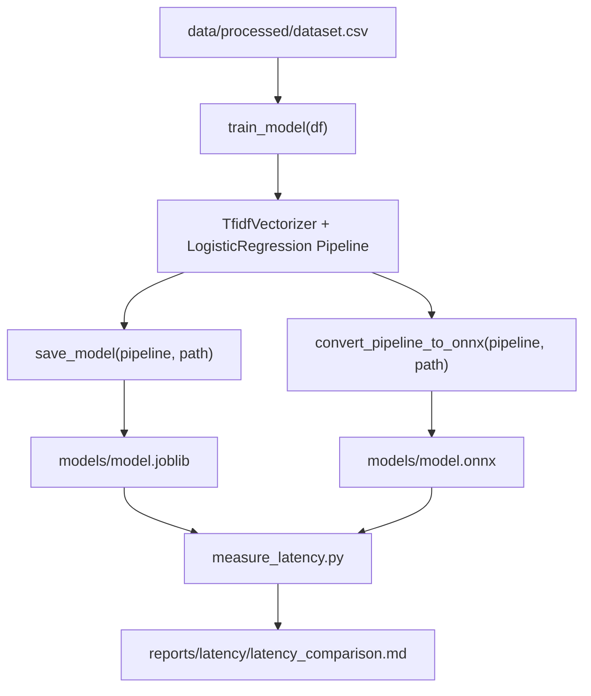
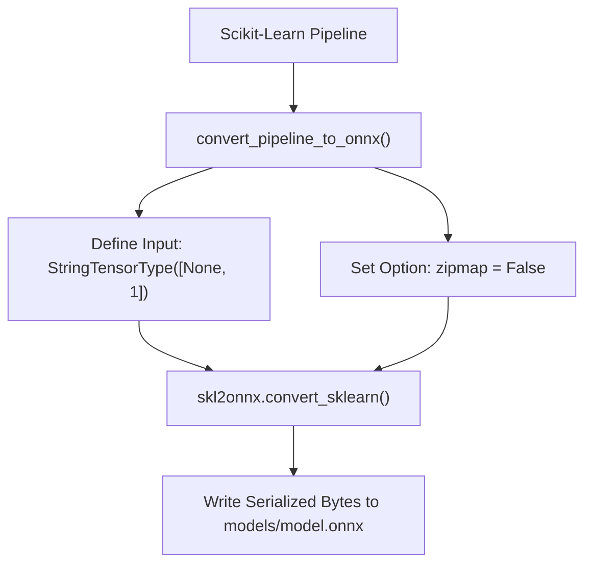
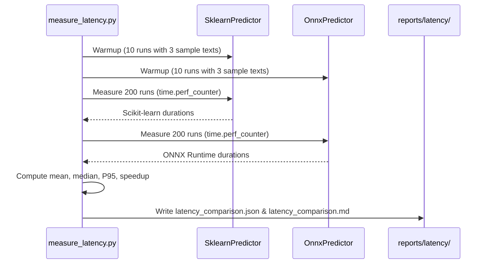

# Model Training & ONNX Optimization Workflow

The medical triage machine learning pipeline trains a text classification model to categorize patient clinical text into three urgency levels (`normal`, `atenção`, `urgente`). To maximize runtime inference efficiency, the workflow includes model serialization to standard Scikit-Learn `joblib` format, conversion into an optimized Open Neural Network Exchange ([ONNX](https://onnx.ai/)) graph format using `skl2onnx`, and comparative latency benchmarking between backends.

For background on data preparation and serving architecture, refer to [Data & Urgency Mapping](../concepts/data-and-urgency-mapping.md) and [Inference & Serving](../concepts/inference-and-serving.md).

---

## End-to-End Workflow Overview

The pipeline transitions processed dataset records through model fitting, serialization, ONNX export, and latency evaluation.


*Figure 1: Complete data flow from dataset input through training, serialization, ONNX conversion, and latency report generation.*

---

## Pipeline Architecture & Model Training

The core model implementation resides in `src/medical_triage_mlops/ml/train.py`. The training process builds an integrated Scikit-Learn `Pipeline` composed of feature extraction and classification stages:

1. **Feature Extraction (`TfidfVectorizer`)**:
   - `max_features=20_000`: Caps the vocabulary size at 20,000 terms to balance accuracy and memory footprint.
   - `stop_words="english"`: Removes standard English stop words.
   - `ngram_range=(1, 1)`: Extracts unigram token frequencies.

2. **Classification (`LogisticRegression`)**:
   - Multi-class classification using `LogisticRegression(max_iter=1000)` to ensure convergence across all classes.

```python
def build_pipeline() -> Pipeline:
    return Pipeline(
        [
            (
                "tfidf",
                TfidfVectorizer(max_features=20_000, stop_words="english", ngram_range=(1, 1)),
            ),
            ("clf", LogisticRegression(max_iter=1000)),
        ]
    )
```

### Dataset Splitting and Evaluation

Model training is handled by `train_model(df, test_size=0.2, random_state=42)`:
- Performs a stratified split on the target label (`stratify=df[LABEL_COLUMN]`) into 80% training and 20% validation sets.
- Fits the `Pipeline` on training data (`x_train`, `y_train`).
- Evaluates validation accuracy and class-level precision/recall using `classification_report(..., output_dict=True, zero_division=0)`.

### Joblib Serialization

Once trained, the pipeline is serialized to disk using `save_model`:
- Ensures the parent directory exists (`path.parent.mkdir(parents=True, exist_ok=True)`).
- Dumps the complete `Pipeline` object via `joblib.dump(pipeline, path)`.
- Models are reloaded dynamically using `load_model(path)` during inference or downstream export tasks.

---

## ONNX Format Conversion

To eliminate Python execution overhead and optimize vector math during serving, trained pipelines are converted to the ONNX graph format via `src/medical_triage_mlops/ml/onnx_convert.py`.


*Figure 2: Steps involved in converting a Scikit-Learn pipeline to ONNX format with skl2onnx.*

### Conversion Parameters & Optimizations

The function `convert_pipeline_to_onnx(pipeline, output_path)` configures `skl2onnx.convert_sklearn` with specific parameters:

- **Input Tensor Specification**:
  `initial_types=[("input", StringTensorType([None, 1]))]`
  Defines an input tensor accepting string arrays of shape `[batch_size, 1]`, enabling variable batch sizes at inference time (`None`).

- **ZipMap Disabling Option**:
  `options={id(classifier): {"zipmap": False}}`
  By default, `skl2onnx` appends a `ZipMap` operator to LogisticRegression classifiers, outputting class probabilities as a list of dictionaries. Setting `zipmap: False` forces the converter to produce a dense 2D floating-point NumPy array (`[batch_size, num_classes]`), reducing allocation overhead and simplifying downstream tensor indexing.

- **File Output**:
  Ensures output directories are created and calls `output_path.write_bytes(onnx_model.SerializeToString())`.

---

## Script Orchestration & DAG Integration

The training and conversion pipeline can be executed either via standalone CLI scripts or through Apache Airflow DAG tasks.

### Standalone CLI Execution

The script `scripts/train_model.py` orchestrates the complete sequence locally:
1. Reads settings (`get_settings()`) for configured file paths (`models/model.joblib` and `models/model.onnx`).
2. Loads `data/processed/dataset.csv`.
3. Calls `train_model(df)` to build and fit the Scikit-Learn pipeline.
4. Invokes `save_model` to write the `.joblib` model artifact.
5. Invokes `convert_pipeline_to_onnx` to generate the `.onnx` model graph.

```bash
uv run python scripts/train_model.py
```

### Airflow DAG Orchestration

In production, training is automated via the Airflow DAG `medical_triage_training` in `airflow/dags/medical_triage_training_dag.py`. The DAG defines sequential `PythonOperator` tasks:
`ingest_data` → `preprocess_data` → `train_model` → `convert_to_onnx`.

For further details on DAG scheduling and container mounting, see [Airflow Orchestration](airflow-orchestration.md).

---

## Latency Benchmarking

Inference latency between Scikit-Learn and ONNX Runtime backends is measured using `scripts/measure_latency.py`.


*Figure 3: Sequence diagram detailing the latency benchmark execution and report generation.*

### Benchmark Methodology

The benchmarking script `scripts/measure_latency.py` measures performance under controlled conditions:
- **Sample Inputs**: Batch of 3 representative clinical texts (`SAMPLE_TEXTS`).
- **Warmup Phase**: Executed `WARMUP_RUNS = 10` times to warm CPU caches and initialize ONNX Runtime sessions.
- **Measured Iterations**: `MEASURED_RUNS = 200` calls recorded using `time.perf_counter()`.
- **Metrics Collected**: Mean duration (`mean_ms`), median duration (`median_ms`), and 95th percentile duration (`p95_ms` calculated at `int(len * 0.95)`).

### Class Label Alignment in ONNX Runtime

Because ONNX graph conversion does not embed Scikit-Learn's string class labels directly inside probability tensor metadata, `OnnxPredictor` in `src/medical_triage_mlops/ml/inference.py` relies on Scikit-Learn's deterministic class sorting behavior `sorted(unique(y))`. It initializes label mapping with `self._classes = sorted(URGENCY_LABELS)` to ensure class probabilities match expected label order (`atenção`, `normal`, `urgente`).

### Benchmark Results

Running `uv run python scripts/measure_latency.py` generates benchmark reports stored at `reports/latency/latency_comparison.md` and `reports/latency/latency_comparison.json`.

| Backend | Mean (ms) | Median (ms) | P95 (ms) |
|---|---|---|---|
| **scikit-learn** | 0.947 | 1.024 | 1.460 |
| **ONNX Runtime** | 0.373 | 0.273 | 0.679 |

- **Speedup (ONNX vs scikit-learn)**: **2.54x faster** mean inference latency.
- ONNX Runtime significantly reduces both median latency (0.273 ms vs 1.024 ms) and P95 tail latency (0.679 ms vs 1.460 ms), making it the optimal backend choice for high-throughput REST API serving.

For configuration instructions on selecting the active inference backend via `MODEL_BACKEND`, see [Inference & Serving](../concepts/inference-and-serving.md).

---

## Testing & Validation

The training and ONNX conversion pipelines are thoroughly validated by automated unit tests in `tests/`:

- **Model Training Tests (`tests/unit/test_train.py`)**:
  - `test_train_model_fits_and_predicts`: Verifies that `train_model` produces a fitted pipeline capable of classifying urgent input text and populating accuracy metrics.
  - `test_save_and_load_model_roundtrip`: Confirms that serialized `.joblib` pipelines retain identical predictions after being loaded back from disk.

- **ONNX Conversion Tests (`tests/unit/test_onnx_convert.py`)**:
  - `test_onnx_predictions_match_sklearn`: Converts a trained pipeline to ONNX and asserts that predictions generated by `onnxruntime.InferenceSession` strictly match `pipeline.predict()` outputs across a test set of clinical texts.
